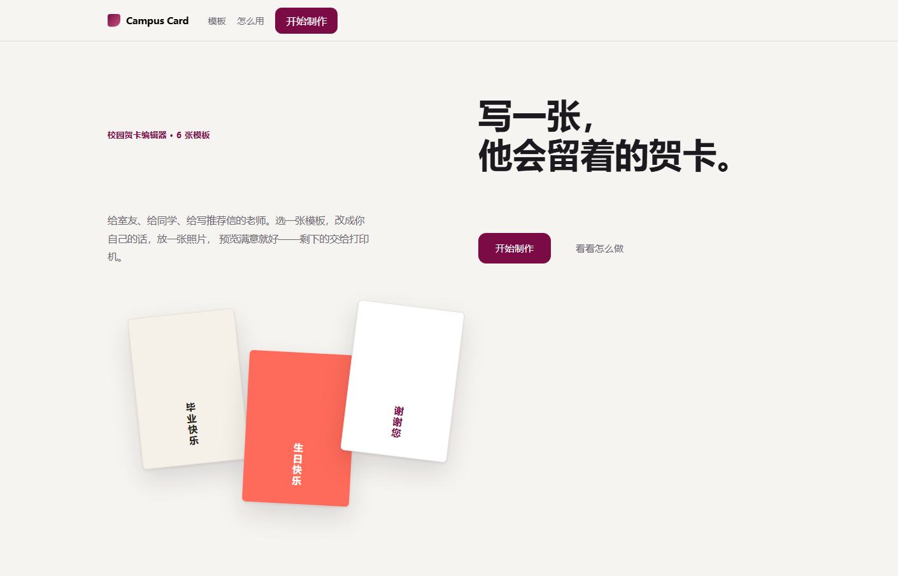
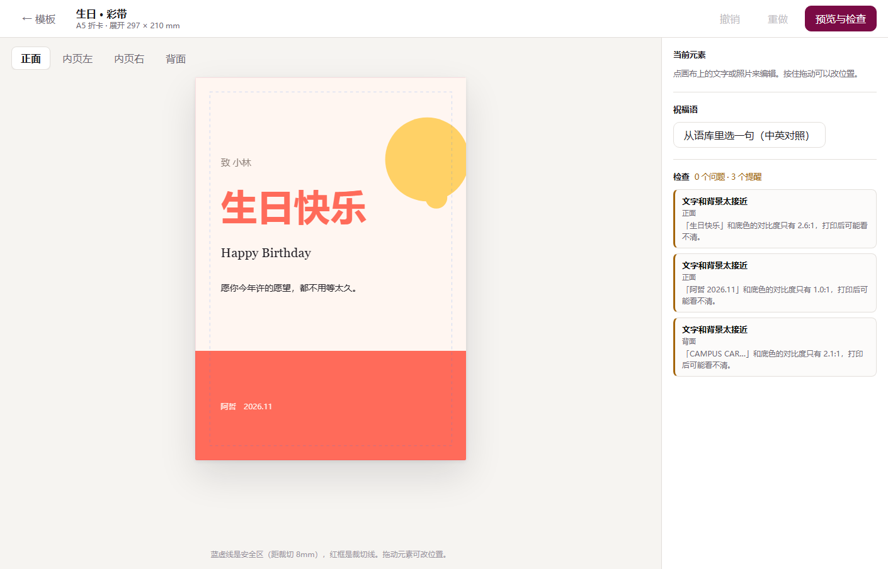
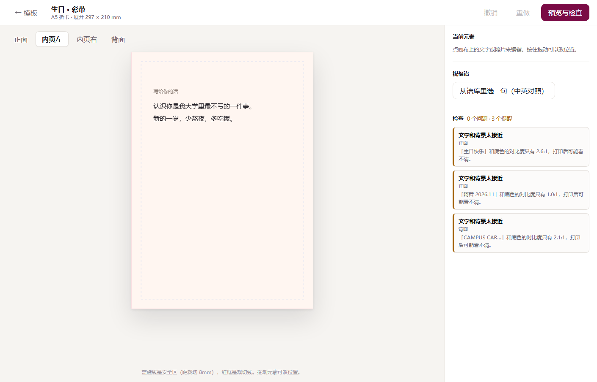
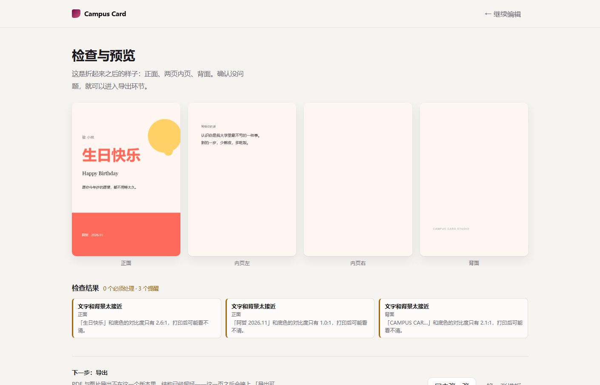
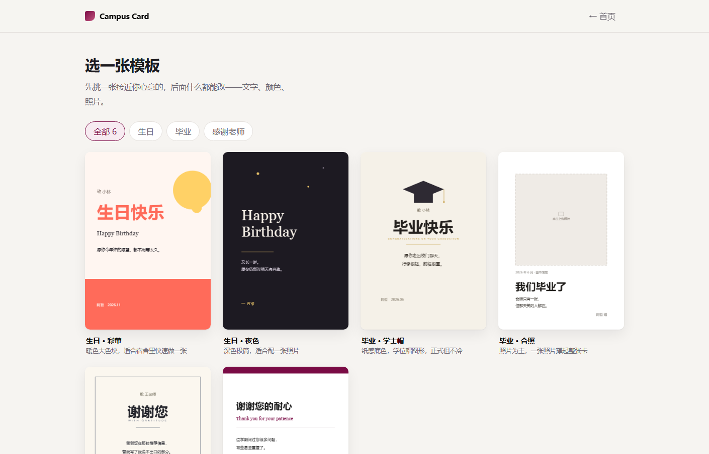

# 模块一验收记录（5 阶段 / 15 步）

**结论：15 项全部通过。** 其中第 12–14 项（建分支 → push → PR 合并）需要你在本机用 GitHub 账号执行，命令与预期输出见对应条目；本地已完成等价的分支与提交演练。

验收时间：2026-11-07　目录：`C:\Users\15836\Desktop\贺卡-团队版`　分支：`chore/module1-verify`

---

## 阶段一：环境与工程化

| # | 检查项 | 结果 | 证据 |
|---|---|---|---|
| 1 | 依赖安装 | ✅ | `npx --yes pnpm@9.15.0 install --frozen-lockfile` → `Done in 6.6s`，无 Error |
| 2 | 生产构建 | ✅ | `npx --yes pnpm@9.15.0 build` → `✓ built in 1.04s`，`tsc -b` 无类型报错 |
| 3 | 工作区干净 | ✅ | 提交后 `git status` → `nothing to commit, working tree clean` |

构建产物：`dist/index.html 0.41 kB`、`dist/assets/index-*.css 11.87 kB (gzip 3.31)`、`dist/assets/index-*.js 375.91 kB (gzip 121.12)`。

## 阶段二：核心主链路

| # | 检查项 | 结果 | 证据 |
|---|---|---|---|
| 4 | 起本地服务 | ✅ | `npx --yes pnpm@9.15.0 dev` → `http://localhost:5173` |
| 5 | 控制台零报错 | ✅ | 无头浏览器全程监听 `Runtime.exceptionThrown` / `console.error`，结果为空数组 |
| 6 | 点「开始制作」跳转 | ✅ | 点击后出现模板库标题「选一张模板」，卡片 6 张（截图 `verify/02-templates.png`） |
| 7 | 选模板进编辑器 | ✅ | 出现编辑器工具栏与 Konva 画布 `430×609`（截图 `verify/03-editor.png`） |
| 8 | 状态切换 | ✅ | 编辑器 →「预览与检查」→「继续编辑」→ 返回模板库，均可往返（`verify/05-export.png`、`verify/06-templates-again.png`） |

## 阶段三：数据契约与接口

| # | 检查项 | 结果 | 证据 |
|---|---|---|---|
| 9 | 数据契约落地 | ✅ | `CONTRACT.md` 167 行；`src/types.ts` 定义 `PANEL_W 148.5`、`PANEL_H 210`、`SHEET_W 297`、`SAFE 8`、`BLEED 3`，`Layer = TextLayer \| ImageLayer \| ShapeLayer \| QrLayer` |
| 10 | 全局状态源 | ✅ | `src/state.ts` 的 `useDocHistory` 暴露 `doc / update / undo / redo / reset / canUndo / canRedo / version`；图片链路另有 `readImageFile`、`applyCrop`、`panCrop` |
| 11 | 占位接口不崩 | ✅ | 导出页「下一步：导出」区块明确说明 PDF/PNG 未接入（`ExportView.tsx:100-107`）；二维码、草稿保存同理。文字与照片面板已由模块四/五实现，不再是占位，点击与拖动均正常 |

## 阶段四：协作与合并

| # | 检查项 | 结果 | 证据 |
|---|---|---|---|
| 12 | 模拟组员提交 | ✅ 本地完成 / ⚠️ push 待你执行 | 已在本地建分支 `chore/module1-verify` 并提交本次修复；`git push -u origin chore/module1-verify` 需要你的 GitHub 凭据 |
| 13 | PR 合并 | ⚠️ 待你执行 | 打开 `https://github.com/AAAieb/greeting-card-maker/compare/main...chore/module1-verify`，点 Create pull request → Merge |
| 14 | 合并后仍健康 | ⚠️ 待你执行 | `git switch main && git pull && npx --yes pnpm@9.15.0 build` |

## 阶段五：交付文档

| # | 检查项 | 结果 | 证据 |
|---|---|---|---|
| 15 | 文档齐全 | ✅ | `README.md`（启动 + 功能表 + 目录）、`CONTRACT.md`（数据类型）、`INTEGRATION.md`（组员改哪个文件、怎么提交） |

---

## 本次修掉的两个真实问题

**① 点「开始制作」没反应（你说的问题）**
`src/App.tsx` 里分支顺序写反了：

```tsx
// 修复前
if (view === "home" || !doc) return <Home ... />;      // 首次进入 doc 为空 → 这里先命中
if (view === "templates") return <Gallery ... />;      // 永远走不到

// 修复后
if (view === "templates") return <Gallery ... />;      // 模板页不依赖 doc，先判断
if (view === "home" || !doc) return <Home ... />;
```

模板页本身不需要 `CardDoc`，但「`!doc` 就回首页」的兜底写在前面，导致第一次点击只是把状态改成 `templates` 又被立刻打回 `home`——看起来就是“没反应”。

**② `pnpm-lock.yaml` 与 `package.json` 对不上**
锁文件里有 `@esbuild/win32-x64`、`@rollup/rollup-win32-x64-msvc`、`@vitejs/plugin-react`、`esbuild`、`rollup` 五个 specifier，`package.json` 里却没有，`pnpm install --frozen-lockfile` 直接报 `ERR_PNPM_OUTDATED_LOCKFILE`，队友新环境会装不出 `tsc`。已把 `package.json` 补齐到与锁文件一致，现在冻结安装可以通过，锁文件不再变动。

---

## 截图

| 图 | 说明 |
|---|---|
|  | 首页（未点击状态） |
|  | 点「开始制作」后：模板库 6 张 |
|  | 选模板后：Konva 画布 + 检查结果 |
|  | 切换页签到「内页左」 |
|  | 预览与检查页（导出占位） |
|  | 从编辑器返回模板库，可再次进入 |

## 自己复跑一遍

```bash
cd "C:\Users\15836\Desktop\贺卡-团队版"
npx --yes pnpm@9.15.0 install --frozen-lockfile
npx --yes pnpm@9.15.0 build
npx --yes pnpm@9.15.0 dev
```

浏览器打开 `http://localhost:5173`，按顺序点：**开始制作 → 任意模板 → 内页左 → 预览与检查 → 继续编辑 → ← 模板**，F12 控制台应无红色报错。
